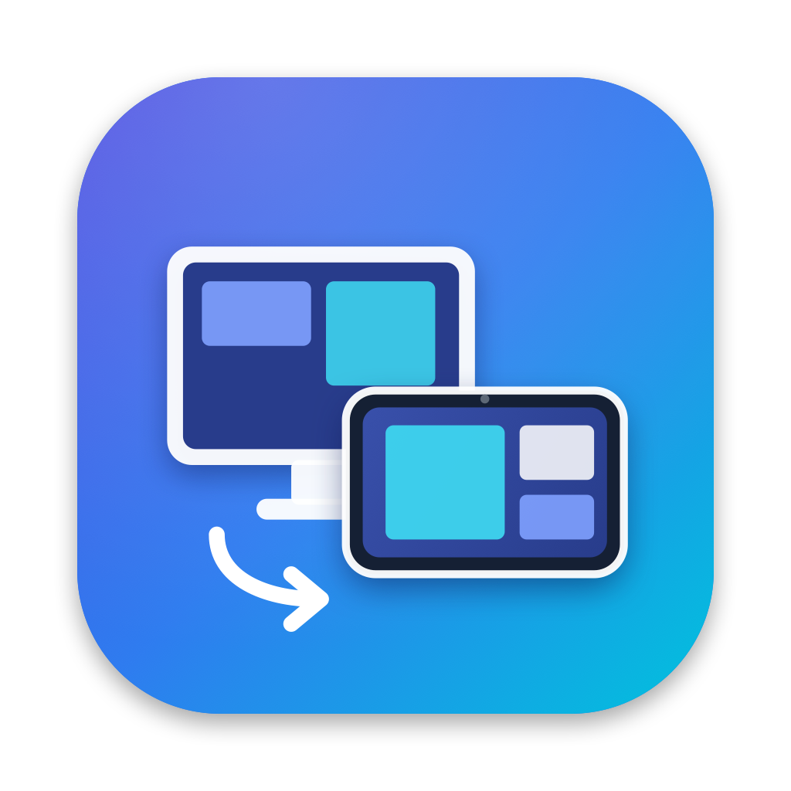

<p align="center">
  
</p>

<h1 align="center">SyncView</h1>

<p align="center">
  Use um <b>Galaxy Tab S9 Ultra</b> como segunda tela do Mac, <b>pelo cabo USB</b>, a <b>120 Hz</b> e na <b>resolução nativa</b> do tablet.
</p>

---

## O que é

O SyncView tem duas partes:

- **App do Mac** (Swift, barra de menus). Ele:
  - cria um monitor virtual com a resolução e a taxa do tablet;
  - captura esse monitor;
  - comprime em HEVC usando o hardware de vídeo do Mac;
  - envia o vídeo pelo cabo USB.
- **App do tablet** (Kotlin, sem dependências externas). Ele:
  - decodifica o vídeo por hardware;
  - mostra em tela cheia a 120 Hz;
  - devolve o toque e a S Pen ao Mac como mouse.

O vídeo passa por um túnel `adb reverse` no cabo. Nada é exposto na rede.

```
Mac                                                      Galaxy Tab S9 Ultra
┌───────────────────────────────────────────┐           ┌──────────────────────────────┐
│ Monitor virtual 2960×1848 @ 120 Hz        │           │ Decodificador HEVC (hardware)│
│        ↓ ScreenCaptureKit (120 fps)       │  cabo USB │        ↓                     │
│ Encoder HEVC (Apple Media Engine)         │ ────────► │ Tela cheia 2960×1848, 120 Hz │
│        ↓ TCP 127.0.0.1:52020              │    adb    │                              │
│ Cliques / rolagem ◄────────────────────── │ ◄──────── │ Toque e S Pen                │
└───────────────────────────────────────────┘           └──────────────────────────────┘
```

## Destaques

- **120 Hz de verdade:**
  - o monitor virtual roda a 120 Hz;
  - a captura e o encoder sustentam 120 fps;
  - o app do tablet força o painel ao modo de 120 Hz.
- **Tela inteira, pixel a pixel:** cada pixel do Mac vira um pixel do tablet, incluindo a área da câmera frontal. Há três tamanhos de interface:

  | Opção | Parece com |
  |---|---|
  | Retina (padrão) | 1480×924 |
  | Mais espaço | 1776×1108 |
  | Máximo de espaço | 1974×1232 |

- **Estável:**
  - o túnel USB é refeito a cada 2 s;
  - o tablet reconecta sozinho;
  - um watchdog refaz a conexão após 4 s de silêncio;
  - se o cabo soltar, o monitor virtual continua existindo por 30 s, então as janelas não pulam para a tela do MacBook.
- **Plug and play:** ao plugar o cabo, o Mac abre o app no tablet sozinho.
- **Toque e S Pen:**
  - toque = clique;
  - dois dedos = rolagem com inércia;
  - toque com dois dedos = clique direito;
  - S Pen pairando move o cursor.

## Desempenho medido

Medido num MacBook Pro M4 Pro, macOS 27.2, com o Galaxy Tab S9 Ultra:

| Item | Resultado |
|---|---|
| Monitor virtual 2960×1848 | 120 Hz nos três modos HiDPI |
| Encoder HEVC 2960×1848, pior caso (tela inteira mudando a cada quadro) | 119,7 fps · ~16 ms p50 / ~29 ms p99 |
| Encoder H.264 na mesma resolução | ~92 fps (por isso é só plano B, limitado a 60 fps) |
| Painel do tablet | 120 Hz |

> O modo `EnableLowLatencyRateControl` do VideoToolbox limitou o HEVC a ~77 fps nessa resolução. Por isso ele fica desligado.

## Requisitos

- Mac com Apple Silicon e macOS 14 ou superior, com as Command Line Tools do Xcode (`xcode-select --install`).
- [Homebrew](https://brew.sh) e `adb`: `brew install android-platform-tools`.
- Galaxy Tab S9 Ultra. Outros tablets Android 11+ com decodificador HEVC devem funcionar, mas não foram testados.
- Cabo USB‑C de dados, de preferência USB 3, ligado direto no Mac.
- Para compilar o APK: `brew install openjdk@21 gradle && brew install --cask android-commandlinetools`. Se preferir, baixe o APK pronto na aba **Releases**.

## Instalação rápida

1. **No tablet:**
   - ative as Opções do desenvolvedor (7 toques em *Número de compilação*);
   - ligue a **Depuração USB**;
   - ligue **Desativar tempo limite de revogação de autorização adb**;
   - em Tela › **Suavidade de movimento**, escolha **Adaptável**.
2. **Conecte o cabo** e aceite "Sempre permitir deste computador" no tablet.
3. **Rode o instalador:**
   ```bash
   ./instalar.sh
   ```
4. **No Mac**, ative o SyncView em **Gravação de Tela** e em **Acessibilidade** (Ajustes do Sistema › Privacidade e Segurança) e reabra o app.
5. **No menu do SyncView**, ative **Abrir ao iniciar sessão**.

Daí em diante: desbloqueie o tablet e plugue o cabo.

O passo a passo completo, com solução de problemas, está no **[TUTORIAL.md](TUTORIAL.md)**.

## Gestos

| Gesto no tablet | Ação no Mac |
|---|---|
| Tocar | Clique (dois toques = duplo clique) |
| Tocar e arrastar | Arrastar |
| Arrastar com 2 dedos | Rolagem com inércia |
| Tocar com 2 dedos | Clique direito |
| S Pen pairando / encostando | Mover cursor / clicar e arrastar (botão lateral = clique direito) |
| Tocar com 3 dedos | Mostrar/ocultar estatísticas (fps, Mbps, Hz, latência de rede) |

## Estrutura

```
SyncView/
├── instalar.sh                 instala tudo (Mac + tablet)
├── TUTORIAL.md                 guia completo
├── tools/make-icons.swift      gera os ícones do Mac e do Android
├── mac/                        app do Mac (Swift Package)
│   ├── build-app.sh            compila e monta SyncView.app (--install → /Applications)
│   ├── setup-signing.sh        certificado local fixo para assinar o app
│   └── Sources/
│       ├── CGVirtualDisplayPrivate/   cabeçalho da API privada CGVirtualDisplay
│       └── SyncView/
│           ├── VirtualDisplay.swift   monitor virtual 120 Hz
│           ├── ScreenCapturer.swift   captura (ScreenCaptureKit)
│           ├── VideoEncoder.swift     HEVC/H.264 por hardware (VideoToolbox)
│           ├── StreamServer.swift     servidor TCP + watchdog
│           ├── ADBManager.swift       túnel USB e abertura do app no tablet
│           ├── InputInjector.swift    toque → eventos de mouse
│           ├── Controller.swift       orquestra o pipeline
│           └── SelfTest.swift         `SyncView --selftest`
└── android/                    app do tablet (Gradle, Kotlin)
    ├── build-apk.sh
    └── app/src/main/java/com/syncview/receiver/
        ├── MainActivity.kt     tela cheia, 120 Hz, estatísticas
        ├── StreamClient.kt     conexão e reconexão
        ├── VideoDecoder.kt     MediaCodec em baixa latência
        └── TouchHandler.kt     gestos e S Pen
```

### Protocolo

TCP big-endian. Cada pacote tem o formato `[tipo u8][tamanho u32][payload]`.

| Direção | Tipo | Conteúdo |
|---|---|---|
| Tablet → Mac | `0x01` HELLO | resolução, Hz, dpi, suporte a HEVC, diagonal, nome |
| Tablet → Mac | `0x02` KEYFRAME | pedido de quadro-chave |
| Tablet → Mac | `0x03` PING | timestamp, a cada 500 ms |
| Tablet → Mac | `0x10` POINTER | ação, botão, x, y normalizados |
| Tablet → Mac | `0x11` SCROLL | x, y, dx, dy |
| Mac → Tablet | `0x81` STREAM_START | codec, largura, altura, fps |
| Mac → Tablet | `0x82` CODEC_CONFIG | VPS/SPS/PPS (Annex B) |
| Mac → Tablet | `0x83` FRAME | flag de keyframe, pts, dados Annex B |
| Mac → Tablet | `0x84` PONG | eco do ping (RTT) |
| Mac → Tablet | `0x85` STATUS | aviso exibido no tablet |

## Diagnóstico

Feche o SyncView antes de rodar:

```bash
open -n /Applications/SyncView.app --args --selftest
```

Depois, veja o resultado:

```bash
grep selftest ~/Library/Logs/SyncView.log | tail -8
```

O teste mostra:
- os modos do monitor virtual;
- a vazão do encoder;
- a captura de ponta a ponta com um cliente de teste.

O log do app fica em `~/Library/Logs/SyncView.log`.

## Limitações

- **API privada:** o monitor virtual usa `CGVirtualDisplay`, a mesma do Sidecar, DeskPad e BetterDisplay. Uma atualização do macOS pode exigir ajuste.
- **Cores em texto fino:** o vídeo usa crominância 4:2:0. Texto colorido muito fino pode ganhar uma leve franja de cor.
- **Sem HDR e sem áudio.**
- **Notch:** a câmera frontal do tablet cobre um pedacinho do topo da imagem.
- **Assinatura local:** o app do Mac é assinado com um certificado local (`mac/setup-signing.sh`), não com um Developer ID. Cada Mac gera o seu próprio certificado ao compilar.
